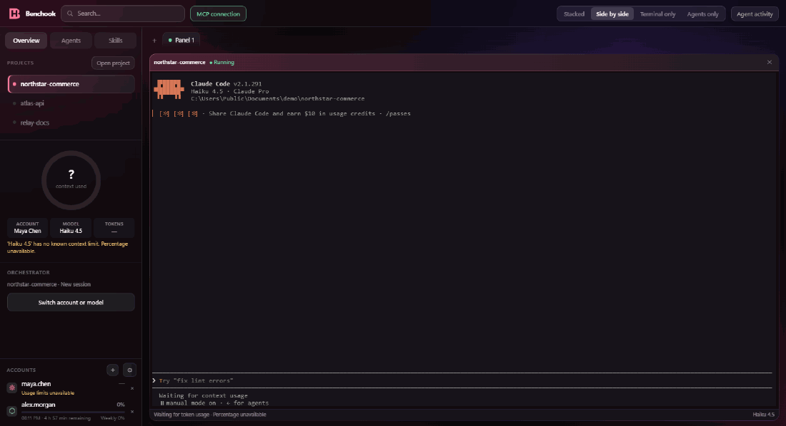
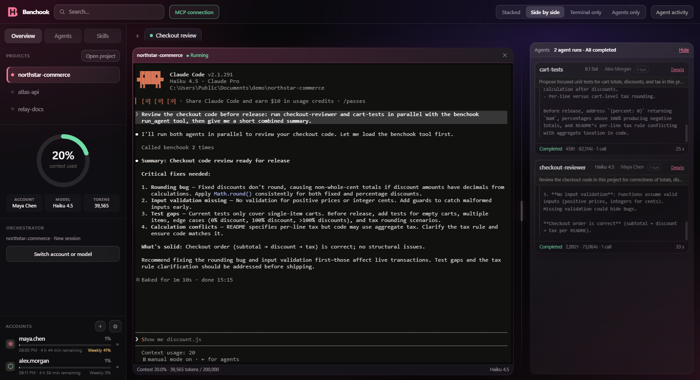
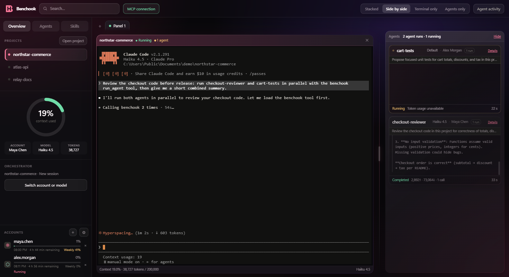
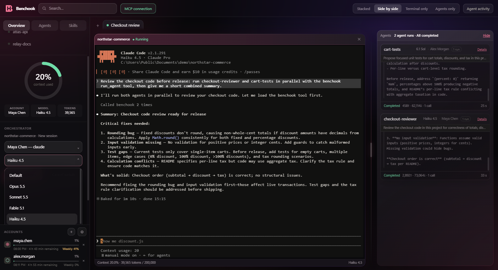
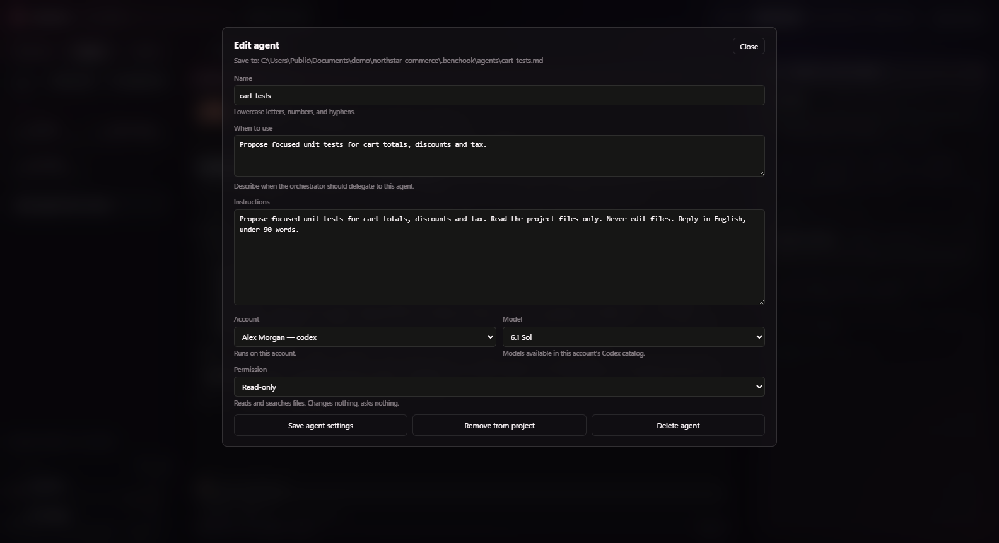
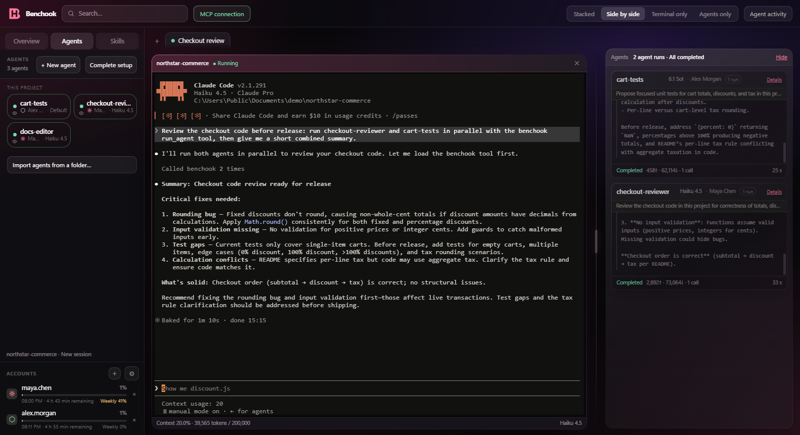
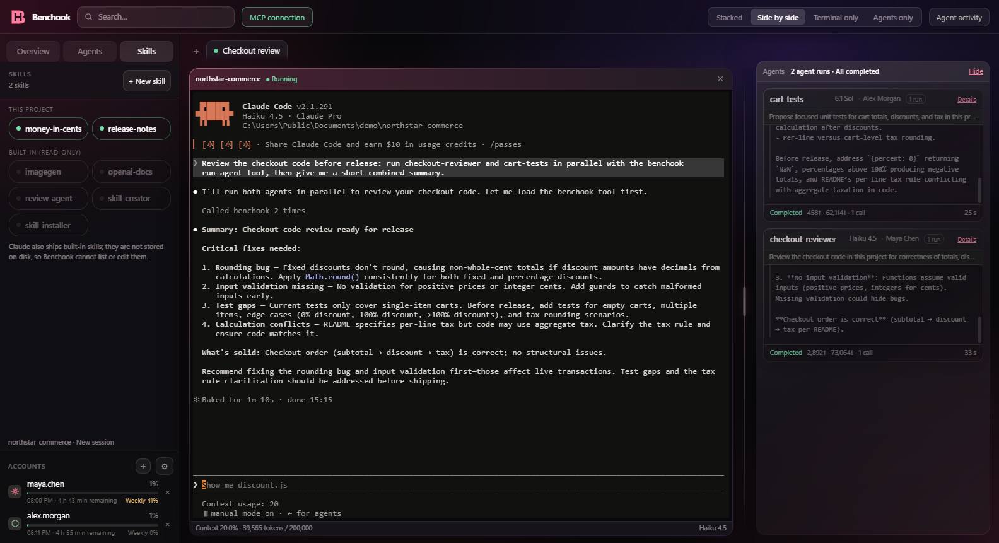
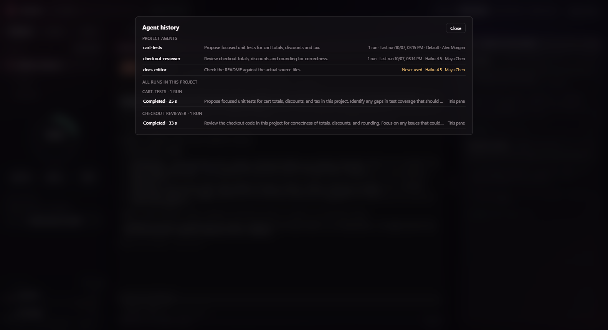
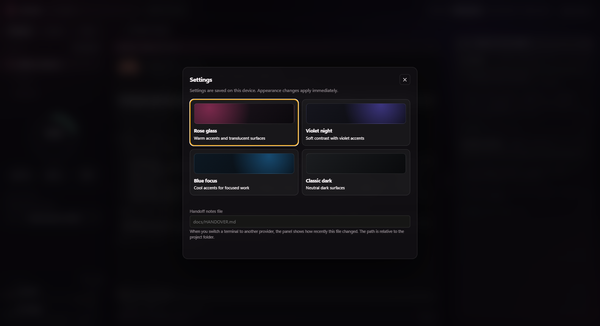

<div align="center">


# Benchook

**A Windows workspace for Claude Code and Codex.**
Projects, accounts, models, reusable agents, and skills in one window, next to the terminals you already use.

[**Download for Windows**](https://github.com/Baki-Yagiz-Dindar/Benchook/releases/latest) ·
[Quick start](docs/QUICKSTART.md) · [User guide](docs/USER-GUIDE.md) · [Limitations](docs/LIMITATIONS.md)

[](https://github.com/Baki-Yagiz-Dindar/Benchook/releases/latest)
[](LICENSE)




<sub>A real Claude Code session hands a review to two agents — one runs on Claude Code, one on Codex — and Benchook shows both runs next to the terminal. Shown faster than real time.</sub>

</div>

## Why Benchook

Working with coding agents across several projects quickly turns into a pile of
terminals, profile folders, and copied configuration. Two problems kept coming back:

- **You cannot see where your usage goes.** Which session is close to the end of
  its context window? Which account still has room before its limit? Which agent
  ran, on which model, and what did it return?
- **One model on one account is rarely enough.** You may want a strong model for
  planning, a faster one for routine work, a second account when the first one is
  near its limit, or a Codex reviewer for code written with Claude Code.

Benchook puts that setup in one place. You still work in the provider's own
terminal; Benchook shows what is happening around it and lets you change accounts,
models, agents, and skills without editing configuration files by hand.

## Highlights

- **Project tabs with real terminals.** Claude Code and Codex run in embedded terminals; layouts are saved per project.
- **Many accounts, real model names.** Add Claude Code and Codex accounts and pick models like *Opus 5.5* or *Sonnet 5.5* from each account's own catalog.
- **Agents across providers.** Define an agent once — instructions, account, model, permissions — and let a Claude Code session call an agent that runs on Codex, or the other way around.
- **Live agent cards.** Every run shows its account, model, tokens, duration, and result; permission questions are answered right on the card.
- **One copy of each skill.** Skills are kept in both providers' folders and in every project that uses them.
- **Context and limits at a glance.** Context usage for the current session and provider-reported limits for every account.

## Screenshots

<table>
<tr>
<td width="50%"><br><sub><b>Workspace</b> — the main session with its agents' results beside it.</sub></td>
<td width="50%"><br><sub><b>Agents at work</b> — one agent on Codex still running, one on Claude Code finished.</sub></td>
</tr>
<tr>
<td><br><sub><b>Switch account or model</b> — real model names and versions for the selected account.</sub></td>
<td><br><sub><b>Agent editor</b> — instructions, account, model, and permission level.</sub></td>
</tr>
<tr>
<td><br><sub><b>Agents</b> — the project's agents with their accounts and models.</sub></td>
<td><br><sub><b>Skills</b> — project skills and the provider's built-in ones.</sub></td>
</tr>
<tr>
<td><br><sub><b>Agent history</b> — every run in the project, with account and model.</sub></td>
<td><br><sub><b>Settings</b> — themes and a handoff notes file for provider switches.</sub></td>
</tr>
</table>

## Requirements

- Windows x64.
- Node.js 22.12 or newer.
- Claude Code, Codex, or both, signed in with your own account. Subscriptions and
  model usage are not included.

## Install

1. Download `Benchook-0.1.0-windows-x64.zip` and its `.zip.sha256` file from the
   [latest release](https://github.com/Baki-Yagiz-Dindar/Benchook/releases/latest).
   GitHub's **Source code** archives are not the portable app.
2. Install what Benchook needs, in PowerShell (skip what you already have):

   ```powershell
   winget install --id OpenJS.NodeJS.LTS --exact --source winget   # Node.js, required
   irm https://claude.ai/install.ps1 | iex                         # Claude Code
   irm https://chatgpt.com/codex/install.ps1 | iex                 # Codex CLI
   ```

   Open a new PowerShell window afterwards.
3. Extract all files to a permanent folder and open `Benchook.exe`. The build is
   unsigned, so Windows may show a publisher warning.

To check the download, compare its SHA-256 hash with the `.sha256` file; see the
[portable ZIP instructions](docs/QUICKSTART.md#windows-portable-zip). You can also
[run from source](docs/QUICKSTART.md#from-source).

## Your first session

1. Open **Accounts**, add an account, and sign in through its provider.
2. Open a project folder from **Overview**.
3. Choose an account and model, then start the orchestrator — your main coding session.
4. Open **Agents** to create an agent or add an existing one, and complete the
   MCP setup when Benchook asks.
5. Ask your main session to use the agent and follow its run beside the terminal.

The [quick start](docs/QUICKSTART.md#open-your-first-project) walks through each
step, and the [user guide](docs/USER-GUIDE.md) covers every view.

## Features in detail

### Projects and terminals

Open project folders and keep their terminals in tabs. Each tab has one main
coding session, called the **orchestrator**. Choose a layout for the terminal,
the agent activity, or both. Benchook saves the workspace, so projects and tabs
come back the way you left them, and switching between them does not close the
terminals running in the background. Search finds projects, agents, skills, and
actions.

### Accounts and models

Each account gets its own local profile, and you sign in through the provider's
own sign-in flow. Changing the account or model within the same provider continues
the same conversation when the provider's local session records are available.
Changing between Claude Code and Codex starts a new conversation; a project handoff
file helps you carry notes across.

### Agents

An agent is a reusable definition: a name, instructions, an account, a model, and a
permission level. It keeps that identity across projects; editing it updates it
everywhere it is used. Agents can run on a different provider or account than your
main session through a local MCP server with `list_agents`, `run_agent`, and
`list_accounts` tools. When an agent needs permission for an action, the question
appears on its live run card, where you allow or deny it.

### Skills

Skills are reusable instructions, sometimes with supporting files. Benchook keeps
one copy of each skill and writes it to both providers' project folders
(`.claude/skills` for Claude Code, `.agents/skills` for Codex). Saving a skill
updates every project that uses it; an edit made outside Benchook is picked up and
copied to the others.

### Context and limits

**Context usage** shows how much of the model's context window the current session
uses, so you can summarize or hand off before it fills up. **Account limits** show
the provider-reported usage of each account. Information the provider has not
reported stays marked as unavailable instead of appearing as zero.

## How it works

- **The official CLIs do the work.** Benchook runs Claude Code and Codex in
  embedded terminals. Your prompts, model calls, and usage go through them and
  your own provider accounts.
- **Accounts are separate local profiles.** Sign-in happens in the provider's own
  flow; Benchook does not ask for or store your password.
- **Information comes from local records.** Context, limits, and agent activity are
  read from the providers' local session records and status output.
- **Agents connect through MCP.** A small local MCP server, started by your coding
  session, lists your agents and runs the ones that need another provider or account.
- **Nothing is hosted.** Benchook has no server. Settings, definitions, and layouts
  stay on your computer.
- **You stay in control.** Benchook does not call models on its own, does not
  submit prompts on your behalf, and asks before changing project or provider
  configuration files.

## What Benchook does not do

- It is not a sandbox. Agents run with the selected provider's permissions;
  Benchook does not add operating-system isolation.
- It does not move a conversation between Claude Code and Codex. Changing provider
  starts a new conversation.
- It does not work autonomously. You direct the main session and decide what to send.
- It cannot guarantee compatibility with every future CLI version. Provider updates
  can change session formats, model lists, or usage reporting.

Read the [limitations](docs/LIMITATIONS.md) and [security notes](SECURITY.md)
before using it on important projects.

## FAQ

**Do I need API keys?**
No. Benchook uses the Claude Code and Codex sign-ins you already have.

**Does Benchook send my code or conversations anywhere?**
Benchook itself has no server. Your work goes to the providers through their own
CLIs, as it would without Benchook.

**Can I use only Claude Code, or only Codex?**
Yes. Either one is enough; agents across providers need both.

**What about macOS or Linux?**
This release is Windows only. Other platforms are not validated.

## Help and contribute

Use the repository's issue templates for bugs and feature requests. Include
reproduction steps and version information; keep account files and private
conversations out of reports. Follow [Security](SECURITY.md) for vulnerabilities.

To work on Benchook, see [Contributing](https://github.com/Baki-Yagiz-Dindar/Benchook/blob/main/CONTRIBUTING.md) and
[Architecture](https://github.com/Baki-Yagiz-Dindar/Benchook/blob/main/ARCHITECTURE.md).

## License

[MIT](LICENSE). Bundled dependencies retain their own
[license notices](THIRD_PARTY_NOTICES.md). Benchook is an independent project,
not an official Anthropic or OpenAI application.
