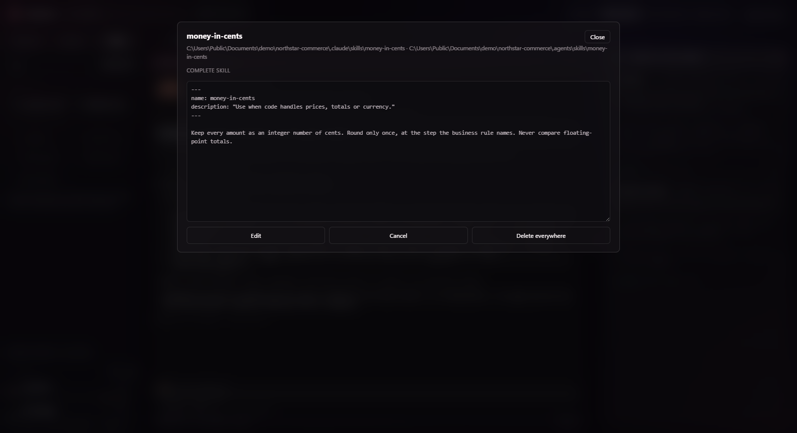

# Using Benchook

[Benchook](../README.md) · [Get started](QUICKSTART.md) · [Limitations](LIMITATIONS.md)

[Projects](#organize-projects-and-terminals) · [Accounts and models](#choose-accounts-and-models) ·
[Agents](#work-with-agents) · [Skills](#manage-skills) · [Usage](#read-context-and-usage) ·
[Settings](#adjust-your-workspace)

## Organize projects and terminals

Open a project folder from **Overview**, then use tabs to organize your work.
Each tab has one main coding session, called the
**orchestrator**. Benchook saves the workspace layout so you can return to it.

Choose a layout for terminals, agent activity, or both. Switching projects or
tabs does not close their background terminals; check running work before closing
a terminal. Search helps you find projects, definitions, and available actions.

## Choose accounts and models

Add accounts in **Accounts** and sign in through the selected provider. Accounts
use separate local profiles. Adding one does not install its CLI or grant access
to the provider's models.

Use the coding session's account and model selector to change its setup.
Check the account identity before starting work. Agents have their own account
and model selections in their definitions.

View the account and model selector

The selector is beside the coding session's controls.

### What happens to the conversation?

| Change | Conversation behavior |
| --- | --- |
| Account or model within the same provider | Benchook can continue a compatible local session when its records are available. Missing records can prevent a switch or resume. |
| Claude Code to Codex, or Codex to Claude Code | A new conversation starts. Chat history and the previous context window are not transferred. |

On Claude startup, Benchook reports when a missing saved session causes it to
start a new one. Continuation can depend on the provider version. Copying a
session between local account profiles can also copy private conversation and
project content; consider who has access to the destination profile.

For a change of provider, you can keep project notes in a
[handoff file](#adjust-your-workspace). It provides a place to record context,
not automatic conversation transfer.

## Work with agents

An agent is a reusable definition: its name, instructions, account, model, and
permissions. It keeps that identity across projects.

1. Open **Agents** and select **+ New agent**, or add an existing definition to
   the current project.
2. Review its instructions, account, model, and permissions. Imported definitions
   should receive the same review as ones you create yourself.
3. Use **Complete setup** when prompted and check **MCP connection**. MCP is the
   connection that lets a coding session use Benchook's agent tools. Review the
   proposed configuration changes and any restart or trust prompts.
4. In the agent's details, select **Copy invocation instructions** and paste them
   into your main coding session. Benchook copies the text; you decide when to
   submit it.

### Example: review a README

Create an agent named `docs-reviewer` with instructions to review documentation
and report findings without editing files. Choose its account, model, and an
appropriate permission level, then add it to your project.

Paste its **Copy invocation instructions** text into your main session and add:

> Ask docs-reviewer to review README.md for unclear setup steps. Report each
> issue with its location and a suggested correction. Do not edit files.

The expected result is a review you can act on, returned to your main session.
For runs launched through Benchook, open **Agent activity** to inspect their
status and results.

### How the session calls an agent

The instructions direct the session to choose a route based on provider and
account: a native subagent when both match, or Benchook's `run_agent` tool when
they differ. A successful setup does not mean an already running session has
loaded the tools; a refresh or restart may be needed.

View project agents and activity

Project definitions appear on the left; reported agent runs appear beside the terminal.

### Shared definitions and permissions

- **Edit** changes the shared definition in every project that uses it.
- **Remove from a project** leaves the definition available elsewhere.
- **Delete** removes the shared agent; read the confirmation before proceeding.

Permission options use the provider's controls. They do not create a separate
operating-system sandbox or guarantee identical enforcement across providers.
Review the descriptions and trust prompts, especially before granting full access.
See [security notes](../SECURITY.md).

## Manage skills

Skills are reusable instructions, sometimes accompanied by supporting files.
Open **Skills** to review available definitions and add them to a project.

Benchook manages project copies in `.claude/skills` for Claude Code and
`.agents/skills` for Codex. User-level and provider-bundled skills may also appear;
being listed does not guarantee that a running session has loaded a skill.

Read a skill's contents and dependencies before importing or editing it. A skill
is one skill everywhere: saving it updates its copies in every project that uses
it, and an edit made outside Benchook is copied to the other provider's folder and
to those projects automatically, newest version first. Removing a skill from one
project is different from deleting it.

View project and available skills

The left panel separates skills added to this project from those available to add.

## Read context and usage

**Context usage** shows how much of the model's context window the current session
uses. It helps you judge when to summarize work or prepare a handoff before
continuing in a fresh session.

**Account limits** show provider-reported usage against the account's limits.
Use them when deciding which account to work with. They are separate from session
context and are not a billing statement or a guarantee of remaining capacity.

Benchook reads supported local session records and provider status output.
Unavailable information stays unavailable rather than appearing as zero. Values
can be stale when the provider has not supplied a newer observation.

Claude account limits come from the last observation of a running Claude Code
session's status line. They can be absent before its first response, after a
reset, or with an unsupported CLI version. If an account's identity changes,
open a new terminal to collect observations for that identity.

## Adjust your workspace

Open **Settings** to choose an appearance. Theme changes apply immediately and
are saved on the device.

**Handoff notes file** accepts a path relative to the project, such as
`docs/HANDOVER.md`. When you switch providers, Benchook shows how recently that
file changed. Keep the notes current and provide relevant context to the new
session yourself.

## Understand local data

Benchook stores account references, layouts, shared definitions, and diagnostic
data locally. Project setup can create or modify agent, skill, hook, and MCP
configuration files. Review the proposed targets and keep backups or version control.

Read [Privacy and security](../SECURITY.md) for data locations and information to
exclude from reports. See [Limitations](LIMITATIONS.md) for platform and
provider constraints.
